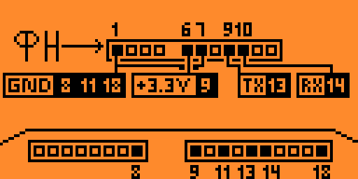

# Тестер фискального накопителя (ФН)

Приложение для Flipper Zero: подключается к фискальному накопителю по UART
(пины 13/14) и показывает его состояние русским текстом. Интерфейс полностью
на русском языке, шрифт с кириллицей встроен в приложение.

## Функциональность

### Информация об ФН
* Серийный номер, этап жизни, состояние смены
* Текущий документ для ОФД и признак получения данных документа
* Номер смены и номер чека (для этапа 2)
* Номер и дата последнего фискального документа (этапы 2–3)
* Текущая и максимальная версия ФФД
* Версия ПО и тип накопителя (МГМ или боевой ФН)
* Флаги предупреждений ФН в человекочитаемом виде

### Информация о фазе жизни ФН
* Дата окончания срока действия
* Количество выполненных и оставшихся регистраций
* Остаток срока в днях
* Ресурс памяти: 5-летнее и 30-дневное хранение
* Процент области уведомлений о маркировке (если ФН его отдаёт)

### Очистка МГМ
Сброс тестового накопителя командой `60 16`. Команда отправляется только
после проверки, что ФН действительно МГМ, и после явного подтверждения;
операцию нельзя прервать во время выполнения (до 30 секунд).

### Справка
* Распиновка подключения ФН к Flipper (экран-схема)
* О приложении: версия, автор, ссылка на проект

## Управление

| Экран | Кнопки |
|---|---|
| Меню | Вверх/Вниз — выбор, OK — открыть, Back — выход |
| Ожидание | Back — вернуться в меню (кроме очистки МГМ) |
| Информация/результат | Вверх/Вниз — строка, Влево/Вправо — страница, Back — меню |
| Подтверждение | Влево/Вправо — выбор кнопки, OK — выполнить, Back — отмена |

## Подключение



ФН подключается к USART Flipper (13 — TX, 14 — RX, GND, +3.3 В). На время
работы приложение отключает определение модулей расширения, USB-консоль при
этом остаётся доступной для логов.

## Структура репозитория

```text
flipper-zero_fn_tester/
├── application.fam          # манифест FAP
├── fn_test_app.c/.h/_i.h    # точка входа, FNApp, ViewDispatcher
├── lib/fn/                  # приватная библиотека (не знает про UI)
│   ├── fn.h                 # umbrella-заголовок
│   ├── core/                # чистые байты, кадр, CRC, коды ответа, типы
│   ├── proto/               # коды команд и парсеры ответов 30h/32h/33h/3Ah/3Bh/3Dh/10h
│   ├── transport/           # UART: DMA-RX, таймауты, отмена
│   ├── fn_worker.c          # одна активная операция, дедлайны, события
│   └── fn_ops.c             # сценарии операций (detect/read info/read life/flash MGM)
├── ui/                      # шрифт, строки, вёрстка, сцены и view
├── icons/                   # иконки и анимация подключения
├── unit_tests/              # on-device тесты (FN_TESTS=1)
├── tests/host/              # host-тесты чистого ядра (make)
├── docs/                    # protocol.md, byte-order.md, ui.md
└── specs/                   # спецификация и план (Spec Kit)
```

## Сборка и запуск

Сборка — только `ufbt` (uFBT):

```bash
ufbt                     # собрать → dist/fn_test.fap
ufbt launch              # собрать, залить и запустить по USB
ufbt cli                 # CLI: log, log debug, top, free
ufbt format              # clang-format
ufbt lint                # статический анализ
```

Тесты:

```bash
make -C tests/host              # чистное ядро, парсеры, форматирование экранов
make -C tests/host asan
make -C tests/host check-layers # проверка границ слоёв

FN_TESTS=1 ufbt launch          # профиль с on-device тестами и командой fn_test
python3 .test_scripts/units.py <имя_устройства>
```

## Документация

* `docs/protocol.md` — соответствие Протоколу ФН v1.2.05, карта «команда → файл»,
  отклонения.
* `docs/byte-order.md` — история ловушки `*_LE`/`*_BE`, канонические функции,
  правила добавления команд.
* `docs/ui.md` — вёрстка 128×64, шрифт с кириллицей, блоки экранов, прокрутка.
